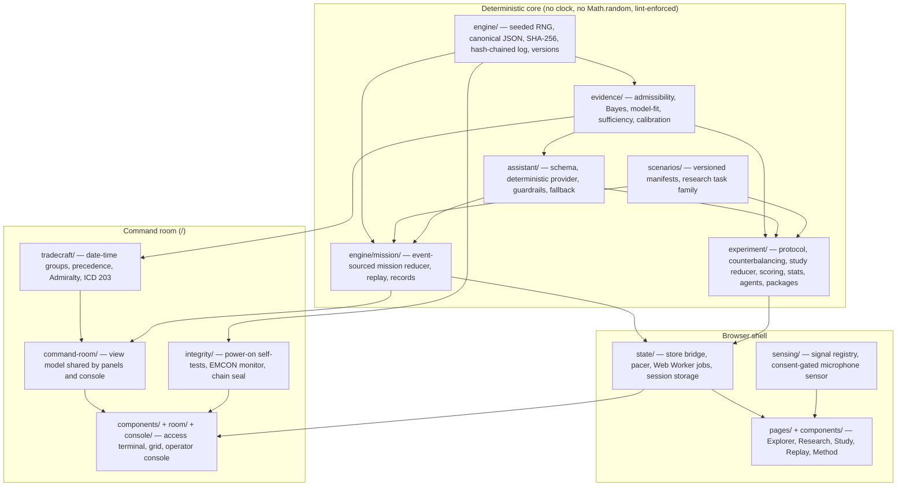

# Orpheus architecture

Orpheus is a single-page React 18 + TypeScript + Vite application with no server. Everything — the
simulation, the evidence analysis, the assistant, the experiments and their statistics — runs in the
browser, and the same modules run in Node for tests and for the result-generating scripts.

The main experience at `/` is the Orpheus command room in its original terminal form: the ORPHEUS
ACCESS TERMINAL, then the twelve-column command grid (`pages/Index.tsx`,
`components/PegasusSimulation.tsx`). It runs on the same deterministic core as the research tools,
which live at addresses the command room does not link to (§9). Section 8 describes the layers that are
specific to the command room.

The design rule for the whole application is that **the interface never owns truth**. A deterministic
core decides what happens; the interface renders it and sends commands. That is what makes sessions
replayable, experiments reproducible and claims checkable.

## 1. Deterministic engine primitives (`src/engine/`)

| Module | Responsibility |
| --- | --- |
| `rng.ts` | sfc32 generator seeded from SHA-256 of `orpheus.rng.v1:<seed>`; named child streams (`deriveSeed`) so adding draws to one system never shifts another; state is four serializable uint32. Reference vectors are pinned in tests. |
| `canonical.ts` | Canonical JSON in the spirit of RFC 8785 (sorted keys, no whitespace); rejects `NaN`, `Infinity`, functions and class instances rather than coercing them. `hashValue` = SHA-256 of canonical JSON. |
| `sha256.ts` | Synchronous SHA-256 so hashing works identically in the worker, the page and Node. |
| `log.ts` | Append-only command log. Each entry commits to its predecessor (`hash = H(seq, command, prevHash)`); the genesis hash commits to the session header. Edits, deletions and reordering are detected. This is integrity checking, not authentication. |
| `clock.ts` | Simulated time in integer ticks; playback speeds; formatting. Wall-clock time never enters state. |
| `numeric.ts` | Quantization and basic arithmetic helpers. Transcendental `Math` functions and `**` are banned in deterministic directories by ESLint, because engines may approximate them differently. |
| `version.ts` | App, engine and schema identifiers recorded in every record and package. |

ESLint enforces the determinism rules (`Math.random`, `Date.now`, `performance.now`, `new Date`,
transcendental functions, `**`) for `engine/`, `evidence/`, `assistant/`, `scenarios/` and `experiment/`.

## 2. Evidence & Uncertainty Engine (`src/evidence/`)

`assessEvidence(context, options)` answers one question: *do the available observations justify a
conclusion?*

1. **Admissibility.** Each item is kept or set aside with a stated rule: assistant statements, assumptions
   and derived estimates are never evidence; integrity failures (digest mismatch), implausible fields,
   sources without a reliability record, sources whose record no longer applies (assumption shift),
   expired items, and repeats of the same origin (relays) are excluded. Excluded items stay visible.
2. **Weighting.** Declared accuracies per source grade (A 0.95 … E 0.55; F unweighted). After its
   freshness window an item's accuracy shrinks linearly toward chance, reaching it at twice the window.
3. **Combination.** Bayes' rule over admissible items from the decision's prior.
4. **Model fit.** With three or more reports, a Poisson-binomial tail test asks whether the observed
   disagreement is plausible under the declared accuracies for any interpretation (α = 0.01).
5. **Sufficiency.** The threshold comes from the payoff matrix: concluding pays when
   `P ≥ (defer − wrong) / (correct − wrong)` = 0.80 for +1 / −4 / 0. Below it, or with no admissible
   evidence, an unresolved conflict or a model misfit, the result is an explicit **insufficient
   evidence** state with a reason.
6. **Evaluated domain.** Probabilities are displayable only for decisions like those the calibration was
   evaluated on (two interpretations, equal priors, ≤ 12 admissible items, model fits).

`assessNaive` is the conventional baseline: the same Bayes' rule on every claim at face value, never
abstaining. `evaluation.ts` samples decisions from the declared model and measures calibration (ECE,
Brier, reliability bins, selective accuracy, coverage) for both; `npm run evaluate` writes the committed
record `src/assistant/calibration.record.json`, and a test fails if the record is stale.

## 3. Assistant layer (`src/assistant/`)

*The model proposes; a deterministic verifier disposes.*

- `schema.ts` — zod schemas per condition. **B** (conventional): a conclusion only. **C** (explainable):
  conclusion, cited evidence, alternatives. **D** (uncertainty-aware): adds unknowns, a probability only
  when permitted, a bounded recommendation, and abstention. Recommendation kinds are limited to analysis
  and verification (`verify-independently`, `request-update`, `check-integrity`, `compare-sources`,
  `review-before-relying`); none is an action.
- `providers/deterministic.ts` — the default provider, built on the evidence engine. No network, no model.
- `providers/perturbed.ts` — simulated upstream faults (a conclusion contradicting its own citations;
  claimed confidence the evidence cannot support) for the robustness laboratory.
- `guardrails.ts` — structural checks for every condition (schema, condition and decision ids, known
  hypotheses and evidence, no citation of AI statements, no operational language) and epistemic checks
  for D (conclusion must be sufficient and match the leading interpretation, citations consistent,
  probability must come from an evaluated method inside its domain and be reproducible). Violations
  either reject the proposal or repair the offending part.
- `index.ts` — `runAssistant` returns the proposal, the guardrail verdict, the displayed output and
  whether the deterministic fallback was used.
- `providers/externalModel.ts` — an OpenAI-compatible adapter whose proposals pass the same guardrails.
  **Not connected to the interface**: model outputs are not reproducible, so connecting it requires
  recording each displayed output in the session log, plus a Content-Security-Policy change.

AI output is rendered with an "AI statement, not evidence" label and is structurally unable to enter the
evidence set: the engine excludes `ai-statement` items and the guardrails reject proposals that cite them.

## 4. Scenarios (`src/scenarios/`)

- **Mission manifests** (`orientation.ts`, `building47.ts`; schema in `types.ts`, validated in
  `schema.ts`) declare sources, decisions, hypotheses, priors, ground truth (fixed or seeded), evidence
  recipes (claim modes, delays, relays, corruption, red-team-only items), expected observations,
  assumption shifts, courses of action with stances and effects, phases and payoffs. Each manifest has a
  content hash; replay requires an exact match.
- **Research task family** (`taskFamily.ts`) separates *structure* (ground truth, which graded sources
  report what, ages, relays, corruption, assistant faults) from *form* (four fictional narratives). Eleven
  information conditions: clean, conflict, missing, stale, corrupted, echo, assumption-shift,
  misleading-confidence, overload, ai-contradictory, ai-overconfident. Generated sources follow the
  declared model exactly; adversarial conditions violate it on purpose.

## 5. Mission engine (`src/engine/mission/`)

An event-sourced reducer: `reduceMission(state, command, manifest)` is pure. Commands: `advance`,
`advancePhase`, `setAutoAdvance`, `toggleRedTeam`, `setCondition`, `inspectEvidence`, `commitDecision`,
`note`. World systems (tracks, squad, vitals, intel, red team) draw from separate seeded streams on a
tick schedule. Decisions open by phase and prerequisite; their evidence is generated from the seed when
they open, and red-team evidence is injected into open decisions when the red team activates. Committing
validates availability and option, rejects duplicates and conflicting commitments, applies effects, and
scores the course against the sampled ground truth (with a penalty when the course relied on a false
interpretation). Invalid commands are rejected without being logged.

`session.ts` records each accepted command in the hash chain, with a state-hash checkpoint after every
command other than a single-tick advance and at least every 15 simulated seconds. `record.ts` exports and imports records (zod-validated). `verifyReplay` rebuilds the
session from seed and log and compares every checkpoint; it refuses exact replay when the engine major
version or manifest hash differs and reports why. v1 records import read-only. `compare.ts` reruns each
committed decision's evidence through conditions B–D for the after-action comparison.

## 6. Experiment framework (`src/experiment/`)

| Module | Responsibility |
| --- | --- |
| `protocol.ts` | The preregistered protocol as data: conditions, design, block mix, payoff, metrics with definitions, hypotheses H1–H7 with direction and family, analysis plan, exclusions, questionnaires. Its hash is recorded everywhere. |
| `counterbalance.ts` | 4×4 Williams square (first-order carryover balanced); trial sets and narrative forms rotate with the square. |
| `study.ts` | Study reducer: practice, blocks, sequential advice (answer first, then the assistant, then a final answer), questionnaires, withdrawal; hash-chained log, replay verification, restore-from-log. Optional custom designs (evidence mix, scenarios, conditions) are omitted when unused so protocol sessions keep their hashes. |
| `scoring.ts`, `metrics.ts` | Utility against ground truth under the payoff; false alarms, misses, missed critical information, agreement with the declared analysis, reliance metrics (over-reliance, appropriate acceptance/rejection, RAIR, RSR), abstention acceptance, Brier and overconfidence of stated confidence, workload, comprehension, comfort. |
| `stats.ts` | Wilson intervals, seeded percentile bootstrap, bootstrap p-values, Holm–Bonferroni. |
| `agents.ts`, `batch.ts` | Seven scripted baseline participants (no AI service); batches with protocol or resampled materials, per-condition summaries, hypothesis tests, robustness tables. |
| `package.ts`, `reproduce.ts` | Research packages (configuration, versions, seeds, materials, every trial, model outputs, questionnaires, summaries, metric definitions, replay logs, limitations, privacy statement) with a content hash; verification by replay and, for simulated batches, regeneration; human-study packages with the protocol's exclusion rule; combination of participant packages after verification. |

## 7. Sensing (`src/sensing/`)

`registry.ts` lists every displayed signal as **measured**, **simulated** or **inferred** (none inferred),
with method, unit, what it indicates and what it does not. `microphone.ts` is the only measurement:
`LocalMicrophoneEnergySensor.start()` requires a consent token created by an explicit user action,
processes audio locally (low-frequency energy, quality flag, timestamps), never stores samples, and
`stop()` ends every track and the audio context. Generated tones start silent and are capped.

## 8. Command room (`components/PegasusSimulation.tsx`, `components/room/`, `command-room/`, `console/`, `tradecraft/`, `integrity/`)

The command room keeps the look of the original (green on black, monospace, square bordered panels, the
twelve-column grid of September 2026) and replaces everything underneath it.

- **Access terminal** (`components/AccessTerminal.tsx`). The original boot sequence, typed line by line
  (Enter skips it; reduced motion prints it at once). The phrase is public (`HELP` prints it unless
  `VITE_ACCESS_HINT=false`) and grants nothing. After the phrase, the power-on self-tests run in the two
  seconds the original spent waiting.
- **Power-on self-tests** (`integrity/selftest.ts`), in the spirit of FIPS 140-3 known-answer tests:
  SHA-256 against FIPS 180-4 vectors; a differential test against the browser's WebCrypto on 4 KiB of
  random input (skipped outside secure contexts); the sfc32 stream for a fixed seed; canonical JSON key
  order; tamper detection (an edited log entry must be caught at its sequence number); a scripted
  Building 47 run whose final state hash is pinned (`PROBE_FINAL_STATE_HASH`); replay verification of
  that run; and the entropy source. A failure does not lock the room, but it is printed and shown in the
  status line, because records made by that browser may not verify elsewhere. An intended change to the
  engine or the manifest changes the pinned hash; `integrity.test.ts` fails until it is updated.
- **Engine binding** (`components/room/panels.tsx`). `pages/Index.tsx` creates a `MissionStore` for
  Building 47 with a fresh CSPRNG seed (or `?seed=`), with the uncertainty-aware analyst (condition D).
  The pacer records one `advance` per second, paused while the tab is hidden. Each panel subscribes to the
  smallest stable slice it shows (tracks, squad, vitals, metrics, timeline), so a tick re-renders only
  what changed. Operator actions (commits, phases, red team, microphone, NeuroSim, touch input at most
  every two seconds, calibration, export) are engine commands or notes in the hash-chained log.
- **View model** (`command-room/model.ts`). Pure functions shared by the panels and the console: the
  numbered shortlist, what each course assumes (commit, act on a report, verify, hedge), the analyst view,
  SITREP lines, the mission strip's input and the temporal archive's coordinates (one timeline per
  committed decision; the moment cycles through the phase's auto-advance window).
- **Tradecraft** (`tradecraft/`, under the determinism lint rules).
  - Date-time groups `DDHHMMZ MON YY` in Zulu, computed with integer civil-calendar arithmetic (no
    `Date`); tick 0 is anchored to the wall clock when the room opens, for display only.
  - Precedence: CRITICAL, HIGH, MEDIUM, LOW → FLASH (Z), IMMEDIATE (O), PRIORITY (P), ROUTINE (R).
  - Admiralty grades: reliability from a declared source record; credibility from corroboration. For a
    decision's evidence, an admissible item's digit follows the balance of independent origins that agree
    minus those that disagree (≥2 → 1, 1 → 2, 0 → 3, −1 → 4, ≤−2 → 5); a failed integrity or plausibility
    check gives 5; an unweighable, expired or reassessed source gives 6; a repeated origin takes its
    original's grade; context items are not graded. For the generated SITREP, reports corroborate each
    other when a different discipline names the same place, grid, route, sector or zone; red-team
    injections are F6; your own recorded courses are marked OWN.
  - ICD 203: a probability is put into words (e.g. "likely, 55–80%") only when the assistant itself
    reports it, that is, when it is calibrated for the conditions. Analytic confidence is stated
    separately: low when the evidence establishes nothing; high only with two or more independent origins
    behind the leading interpretation and no conflict, model misfit, missing observation or aging item.
- **Operator console** (`console/`, `components/room/OperatorConsole.tsx`). A command line over the same
  context the panels use, opened with the backtick key: tokenizer, tab completion, history, and a
  `[y/N]` confirmation for anything that changes the record (`commit`, `new`). `verify` re-executes the
  live session from its seed and compares every checkpoint; `seal` prints the chain head; `egress`,
  `selftest`, `sitrep`, `brief`, `log` and the rest read state without changing it.
- **Integrity in view.** The status line shows the seed, mission time, date-time group, phase, chain
  length and head fingerprint, the EMCON state (`integrity/egress.ts`: Resource Timing plus CSP violation
  reports) and the self-test result; each opens the console on the command that explains it.
- **Delivery.** One production Content-Security-Policy (`config/securityPolicy.ts`) is written into
  `index.html` at build time and sent by `vercel.json` with `frame-ancestors 'none'`; a unit test keeps
  them identical. `vercel.json` also serves the single-page app for deep links and caches hashed assets
  for a year. React, zod, three.js and the 3D renderer are separate chunks, so three.js loads only when the
  NeuroSim view opens.
- **Drawing.** The tactical map and cohesion field redraw on canvas only when their data change. The
  breathing animation is paced at 30 updates a second and reaches only the ring, the ambient overlay and
  the grid's transform (never a blur, which re-rasterizes every frame and softens text).

## 9. Browser shell (`src/state/`, `src/pages/`, `src/components/`)

- `state/missionStore.ts` owns the mission session and exposes slices through `useSyncExternalStore`;
  `usePacer` turns wall-clock playback into recorded `advance` commands.
- `state/researchJobs.ts` runs batches, verification, combination and calibration in a module Web Worker
  (`workers/research.worker.ts`), with a main-thread fallback.
- `state/studyProgress.ts` keeps an in-progress participant session (configuration and log only) in
  session storage so a reload resumes by replay; `state/packageStore.ts` hands a package to the
  workbench in memory.
- Routes: `/` is the command room (§8). The research tools load lazily at `/explore/:scenarioId`
  (Explorer; `orientation` is the guided five-minute scenario), `/research` (workbench tabs: Protocol,
  Simulate, Human study, Results, Calibration, Reproduce, Assumptions), `/study` (participant runner),
  `/replay` and `/method`. They keep their own instrument components (`components/instruments/`) in the
  research palette; the command room's panels in `components/` carry the terminal styling.
- Visual system: design tokens in `index.css` and `tailwind.config.ts`. The default tokens are the
  terminal palette (phosphor green on black, square corners), so every shadcn primitive renders dark in
  the command room. The research palette (graphite surfaces, spectral teal, amber for AI statements) is
  scoped: `AppShell` adds the `o-theme` class to `<html>` while a research page is open; provenance badges carry icon + label + border style so status never depends
  on color; charts (forest plot, reliability diagram) use a palette validated for color-vision deficiency
  and contrast, with focusable marks, tooltips and table twins.

## 10. Privacy and security

- No accounts, no analytics, no network calls: the production Content-Security-Policy
  (`config/securityPolicy.ts`, in the page and as a header) denies everything but the app's own origin,
  the EMCON monitor reports anything that left or was blocked, and end-to-end tests assert that no request
  leaves the origin.
- Stored locally: display preferences (`localStorage`), an in-progress study session (`sessionStorage`,
  cleared with the tab). Records and packages leave the browser only when the user downloads them.
- Exports never contain raw audio, names, contact details, free text or device identifiers.
- The access terminal on the main page is fiction: its phrase is public and it grants nothing. The
  seal and the checkpoint hashes detect alteration of a record; they do not authenticate who made it.

## 11. Verification

| Layer | What runs |
| --- | --- |
| Unit (Vitest) | RNG reference vectors, canonical JSON, hash chain and tamper detection, every admissibility rule, calibration, guardrails and fallback, manifests, mission reducer rules, replay and version mismatch, world bounds, study reducer, scoring, statistics, agents, packages, exclusions, combination, custom designs, microphone consent and shutdown, evidence-ladder claims against generated results; for the command room: the self-tests and the pinned engine probe (plus the million-character FIPS vector and WebCrypto agreement across lengths), date-time groups against the host calendar over four centuries, precedence, Admiralty grading and ICD 203 terms, the EMCON monitor, the seal, every console command, the view model, the classic terminal copy, and the build policy (chunks, CSP, `vercel.json`). |
| End-to-end (Playwright, Chromium) | The access terminal's sequence, help, lockout counter and self-tests; every view of the command room without errors, with three.js loading only for the 3D view; no overlapping panels at 1280×800, 1440×900 and 1920×1080; commits only after confirmation; the console's brief, commit, verify and egress; the same seed producing a bit-identical state hash in two independent sessions; an exported record verifying in `/replay` and an edited copy failing; the breathing animation reaching only what shows it, without blur; reduced motion; microphone consent and shutdown; the research palette never leaking in. The explorer journey; workbench design → run → export → verify → regenerate; the default batch reproducing, in the browser, the package hash generated in Node; 20,000-trial calibration reproduced in the browser; a complete participant session, withdrawal and resume; axe (WCAG 2.2 AA rules) on the access terminal, the command room, its decision matrix, console, review and consent dialog, and on every research route and dialog; keyboard-only decisions; phone layouts, including every tab of the command room. |
| Static | `tsc` in strict mode for app, config and tests; ESLint including the determinism rules. |
| CI | `.github/workflows/ci.yml`: lint, typecheck, unit tests, build, and regeneration of the committed calibration record and baseline results (any difference fails); a second job runs the Playwright suite in Chromium. |

## 12. Known limitations

- Replay determinism is designed to hold across JavaScript engines but has been exercised only in Node
  and Chromium.
- The study runner is untested with people; timing is measured with `performance.now()` in the page.
- The external-model adapter is not connected (see §3).
- The three.js scene is a decorative view driven by display settings; it writes nothing to the engine and
  is not part of replay. The same holds for the command room's display-only state: the breath and pulse
  settings, the frequency marker, the baseline calibration window and the console's scrollback.
- Date-time groups anchor tick 0 to the wall clock when the room opens. Records keep the export time but
  not that anchor, so a replay shows mission time (T+) rather than the original date-time groups.
- SITREP credibility uses a declared, deliberately simple proxy (another discipline naming the same
  place); it is not a model of real source reporting.
